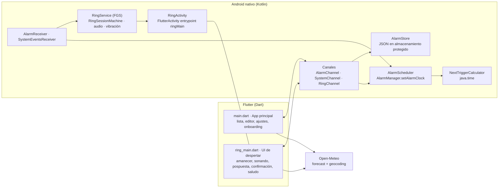
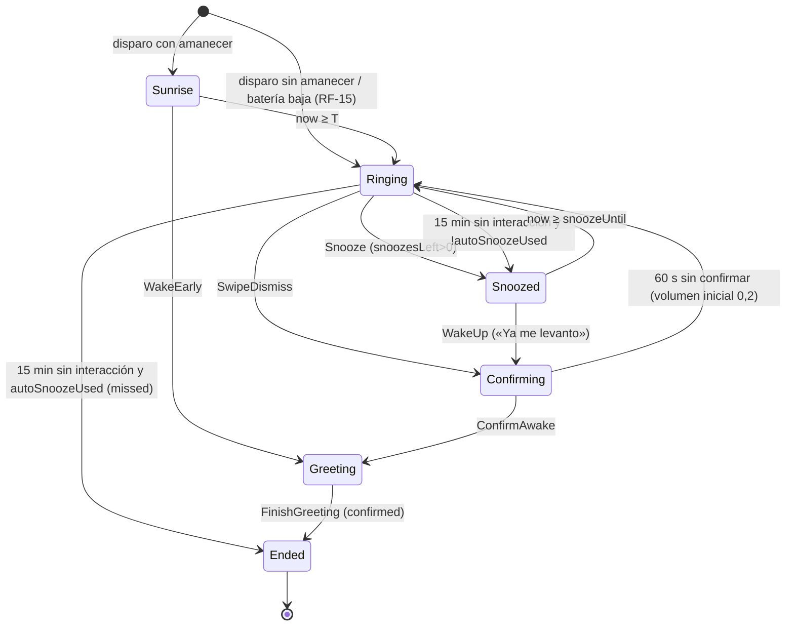

# Arquitectura

## 1. Vista general



| Componente | Responsabilidad | Tecnología |
|---|---|---|
| App principal (`lib/main.dart`) | Lista de alarmas, editor, ajustes, onboarding y permisos | Flutter + Riverpod |
| UI de despertar (`lib/ring_main.dart`) | Pinta el amanecer, controla el brillo de la ventana y muestra sonando, pospuesta, confirmación y saludo. No decide tiempos: los recibe del servicio | Flutter, en `RingActivity` |
| `AlarmChannel`, `SystemChannel` y `RingChannel` | Contratos Dart ↔ Kotlin (§5) | MethodChannel y EventChannel |
| `AlarmStore` | Persiste las alarmas (fuente de verdad) | SharedPreferences en contexto protegido del dispositivo, JSON con `org.json` |
| `NextTriggerCalculator` | Calcula la siguiente ocurrencia y el inicio del amanecer | Kotlin puro + `java.time` |
| `AlarmScheduler` | Programa y desprograma con `AlarmManager.setAlarmClock` | Kotlin |
| `AlarmReceiver` | Recibe el disparo y arranca `RingService` | BroadcastReceiver |
| `SystemEventsReceiver` | Reprograma tras reinicio, actualización o cambio de hora o zona y gestiona las perdidas (RF-41, RF-42) | BroadcastReceiver `directBootAware` |
| `RingService` | Servicio en primer plano de la sesión: máquina de estados, audio, rampa, vibración, foco de audio, wakelock y notificaciones | Kotlin, `MediaPlayer`, `Vibrator` |
| `RingSessionMachine` | Lógica pura de estados y escalada con reloj inyectado | Kotlin puro (JUnit) |
| `RingActivity` | Ventana a pantalla completa sobre la pantalla de bloqueo; aloja la UI de despertar | `FlutterActivity` |

### Secuencia del camino feliz

```mermaid
sequenceDiagram
  participant AM as AlarmManager
  participant R as AlarmReceiver
  participant S as RingService
  participant A as RingActivity (Dart)
  AM->>R: disparo a T−20 min (ACTION_FIRE, alarmId, ringAt)
  R->>S: startForegroundService(START_SESSION)
  S->>S: máquina → Sunrise; wakelock; notificación con fullScreenIntent
  S->>A: abre RingActivity (pantalla encendida, sobre la pantalla de bloqueo)
  A->>S: getSession() + escucha ring_events
  A->>A: pinta sunriseFrame(progress) y setBrightness cada 500 ms
  S->>S: a T: Ringing → MediaPlayer + rampa 3 min
  S-->>A: evento state=ringing
  A->>S: dismissSwipe()
  S->>S: fundido de 2 s → Confirming
  A->>S: confirmAwake()
  S-->>A: state=greeting
  S->>S: restaura el volumen, reprograma la alarma y para el servicio cuando A llama a finishGreeting()
```

## 2. Stack y convenciones

- **Flutter** estable ≥ 3.35 y Dart ≥ 3.9. `pubspec.yaml`: `environment: sdk: ">=3.9.0 <4.0.0"`. El canal y la versión reales se anotan en el README del repo en E01-T01.
- **Android**: `minSdk 26`, `targetSdk` y `compileSdk` 35 (o el mínimo que exija Play al publicar, el que sea mayor). Kotlin y AGP los que genere `flutter create`.
- **Identificador**: `applicationId` `com.migdlp.gentlealarm`. Paquete Kotlin `com.migdlp.gentlealarm`.
- **Nombre visible**: «Despertar suave» (es) y «Gentle Alarm» (en) (SUPUESTO-1).
- **Dependencias Dart** (se añaden con `flutter pub add`, que fija la última compatible en `pubspec.lock`): `flutter_riverpod`, `shared_preferences`, `http`, `uuid`, `intl`, y `flutter_localizations` (sdk). Desarrollo: `flutter_lints`, `mocktail`. Integración: `integration_test` (sdk). No se añade ninguna más sin una ADR nueva.
- **Dependencias Kotlin**: sólo `androidx.core:core-ktx` (ya presente). Pruebas: `junit:junit:4.13.2` y `org.json:json:20240303` (`org.json` está «stubbed» en las pruebas JVM).
- **Tipografía**: Nunito (OFL), con los archivos `Nunito-Regular.ttf`, `Nunito-SemiBold.ttf` y `Nunito-Bold.ttf` en `assets/fonts/`.

### Estructura de carpetas

```
lib/
  main.dart                     # runApp(ProviderScope(child: GentleAlarmApp()))
  ring_main.dart                # @pragma('vm:entry-point') void ringMain()
  l10n/app_es.arb, app_en.arb   # textos (gen-l10n → lib/l10n/gen/)
  src/
    app.dart                    # MaterialApp, rutas y tema
    core/
      theme/palette.dart        # colores (§2.1)
      theme/app_theme.dart
      platform/alarm_channel.dart, system_channel.dart, ring_channel.dart
      time/format.dart          # formateo de horas y «en 7 h 20 min»
    features/
      alarms/domain/alarm.dart            # modelo inmutable Alarm
      alarms/data/alarm_repository.dart   # usa AlarmChannel
      alarms/state/alarms_providers.dart
      alarms/ui/alarm_list_screen.dart, alarm_editor_screen.dart, widgets/
      settings/…   sounds/…   greeting/…   onboarding/…   permissions/…
      ring/domain/sunrise.dart            # sunriseFrame(progress)
      ring/state/ring_controller.dart
      ring/ui/ring_root.dart, sunrise_view.dart, ringing_view.dart,
              snoozed_view.dart, confirm_view.dart, greeting_view.dart
test/  (refleja lib/src/)
integration_test/
android/app/src/main/kotlin/com/migdlp/gentlealarm/
  MainActivity.kt
  alarm/AlarmSpec.kt, AlarmStore.kt, NextTriggerCalculator.kt,
        AlarmScheduler.kt, AlarmReceiver.kt, SystemEventsReceiver.kt
  ring/RingTimings.kt, RingSessionMachine.kt, VolumeRamp.kt,
       RingService.kt, RingActivity.kt, RingNotifications.kt, SoundResolver.kt
  channel/AlarmChannel.kt, SystemChannel.kt, RingChannel.kt
android/app/src/test/kotlin/com/migdlp/gentlealarm/…  (JUnit)
android/app/src/main/res/raw/  birds_dawn.ogg, soft_waves.ogg, light_rain.ogg,
                               chimes.ogg, calm_piano.ogg, singing_bowls.ogg
```

### Convenciones
- Archivos Dart en `snake_case.dart`; una pantalla por archivo; los widgets privados se quedan en el mismo archivo si tienen menos de 80 líneas y, si no, van a `widgets/`.
- Los modelos Dart son inmutables, con `copyWith`, `toMap()`, `fromMap()` y `==`/`hashCode`, escritos a mano (sin generación de código).
- Ningún texto visible queda fijo en el código: todo va en ARB (las claves se nombran en cada tarea).
- Errores de canal: `PlatformException(code, message)`. Dart los convierte en `AlarmException(code)`.
- Kotlin: la lógica pura (calculadora, máquina y rampa) no importa nada de `android.*`, para poder probarla en JVM.
- Pruebas Dart con el sufijo `_test.dart` en la ruta espejo de `test/`. Pruebas Kotlin con el sufijo `Test.kt`.

### 2.1 Paleta (tokens)

| Token | Hex | Uso |
|---|---|---|
| `night` | `#0B1026` | Fondo del tema oscuro y del amanecer al 0 % |
| `nightDeep` | `#05060F` | Parte superior del gradiente al 0 % |
| `dusk` | `#2A1B3D` | Superficies en el tema oscuro |
| `ember` | `#3A0F1E` | Amanecer al 25 % |
| `coral` | `#FF7A3D` | Amanecer al 75 % y acento |
| `honey` | `#FFC872` | Amanecer al 75 % (abajo) |
| `peach` | `#FFB36B` | Luz de la pantalla pospuesta |
| `cream` | `#FFF4E0` | Fondo del tema claro y amanecer al 100 % |
| `inkOnDark` | `#F5EBDD` | Texto sobre fondos oscuros |
| `inkOnLight` | `#2B1A12` | Texto sobre fondos claros |
| `accent` | `#E8693A` | Botones principales en el tema claro (texto `cream`) |

El tema sigue el claro u oscuro del sistema. Las pantallas de despertar ignoran el tema y usan su propia paleta.

## 3. Modelo de datos

### 3.1 `AlarmSpec` (Kotlin) / `Alarm` (Dart): una alarma

Se guarda como un objeto JSON dentro del array de la clave `alarms_v1` en las SharedPreferences `gentle_alarm_store`, obtenidas de `context.createDeviceProtectedStorageContext()`. Otra clave, `schema_version`, vale `1`.

| Campo (JSON) | Tipo | Null | Default | Restricciones | Notas |
|---|---|---|---|---|---|
| `id` | String | no | UUID v4 generado en Dart | único | |
| `enabled` | Boolean | no | `true` | | |
| `hour` | Int | no | 7 | 0-23 | hora local |
| `minute` | Int | no | 30 | 0-59 | |
| `weekdays` | Int[] | no | `[]` | valores 1-7 (ISO, 1 = lunes), sin repetidos y ordenados | `[]` = una sola vez |
| `label` | String | no | `""` | `trim()`, ≤ 40 caracteres | |
| `soundId` | String | no | `birds_dawn` | uno de `birds_dawn`, `soft_waves`, `light_rain`, `chimes`, `calm_piano`, `singing_bowls`, `custom` | |
| `customSoundUri` | String | sí | null | obligatorio si `soundId == custom` | URI SAF con permiso persistente |
| `customSoundName` | String | sí | null | obligatorio si `soundId == custom` | se muestra en la interfaz |
| `sunriseMinutes` | Int | no | 20 | uno de 0, 5, 10, 15, 20, 30, 45 | |
| `rampMinutes` | Int | no | 3 | uno de 1, 2, 3, 5, 10 | |
| `maxVolumePercent` | Int | no | 70 | 10-100, múltiplo de 10 | |
| `vibrate` | Boolean | no | `true` | | |
| `skipRingAtEpochMs` | Long | sí | null | | se salta la ocurrencia cuyo T es exactamente este valor (RF-07) |
| `scheduledRingAtEpochMs` | Long | sí | null | | **sólo lo escribe Kotlin**: T de la ocurrencia programada; null si está desactivada |
| `createdAtEpochMs` | Long | no | ahora | | orden estable en la lista |

Las validaciones las aplica `AlarmSpec.validate()` en Kotlin (error `INVALID_SPEC` con el nombre del campo en el mensaje) y también el editor en Dart.

### 3.2 `SessionSnapshot`: estado de la sesión activa

Se guarda en la clave `active_session` del mismo almacén (para reanudar si el proceso muere) y se envía a Dart por `RingChannel`.

| Campo | Tipo | Notas |
|---|---|---|
| `alarmId` | String | `"preview"` en la vista previa |
| `label` | String | |
| `ringAtEpochMs` | Long | T |
| `sunriseStartEpochMs` | Long | igual a T si no hay amanecer |
| `state` | String | `sunrise`, `ringing`, `confirming`, `snoozed`, `greeting` o `ended` |
| `stateSinceEpochMs` | Long | |
| `snoozesLeft` | Int | 3 → 0 |
| `autoSnoozeUsed` | Boolean | |
| `snoozeUntilEpochMs` | Long? | sólo en `snoozed` |
| `segmentStartEpochMs` | Long? | inicio del tramo actual (en `ringing`) |
| `endReason` | String? | `confirmed`, `missed`, `absorbed`, `preview_done` o `woke_early` |
| `isPreview` | Boolean | |
| `soundFallback` | Boolean | RF-27 |
| `brightnessRampFromSnooze` | Boolean | true en el tramo que sigue a posponer (RF-35) |

### 3.3 Ajustes (sólo Dart, `shared_preferences`)

| Clave | Tipo | Default |
|---|---|---|
| `defaults.sunriseMinutes` | int | 20 |
| `defaults.rampMinutes` | int | 3 |
| `defaults.maxVolumePercent` | int | 70 |
| `defaults.vibrate` | bool | true |
| `defaults.soundId` | String | `birds_dawn` |
| `weather.city` | String (JSON `{name, country, latitude, longitude}`) | ausente |
| `weather.cache` | String (JSON `{temperatureC, weatherCode, fetchedAtEpochMs, cityName}`) | ausente |
| `greeting.lastIndex` | int | -1 |
| `onboarding.done` | bool | false |

### 3.4 Máquina de estados de la sesión



Efectos por transición (los ejecuta `RingService`):

| Transición | Efectos |
|---|---|
| → Sunrise | Notificación del servicio con `fullScreenIntent` a `RingActivity` |
| → Ringing | `StartSound(startVolume, rampMs)`; programa la vibración a +5 min si `vibrate`; programa la escalada a +15 min |
| Ringing → Confirming | `StopSound(fadeMs = 2000)`, `StopVibration` |
| Ringing → Snoozed | `StopSound(fadeMs = 500)`, `StopVibration`, `snoozesLeft--` sólo si es manual, `autoSnoozeUsed = true` si es automático |
| → Ended(missed) | `StopSound(500)`, `ShowMissedNotification` |
| → Ended(cualquiera) | Restaura el volumen del sistema, reprograma la alarma (o la desactiva si es de una sola vez), borra `active_session`, libera el wakelock y para el servicio |
| FocusLost (en Ringing) | Pausa el audio y congela los temporizadores (se guarda el tiempo transcurrido del tramo) |
| FocusGained | Reanuda con una rampa de 30 s desde 0 y descongela los temporizadores |

### 3.5 Constantes (`RingTimings`)

| Constante | Normal | Vista previa |
|---|---|---|
| `sunriseMs` | `sunriseMinutes × 60 000` | 30 000 |
| `rampMs` | `rampMinutes × 60 000` | 30 000 |
| `snoozeMs` | 600 000 | 10 000 |
| `maxSnoozes` | 3 | 3 |
| `vibrationAfterMs` | 300 000 | 15 000 |
| `autoSnoozeAfterMs` | 900 000 | desactivado |
| `confirmTimeoutMs` | 60 000 | 10 000 |
| `confirmRetryStartVolume` | 0,2 | 0,2 |
| `fadeOutMs` | 2 000 | 2 000 |
| `focusResumeRampMs` | 30 000 | 30 000 |
| `previewHardStopMs` | — | 90 000 desde el primer Ringing → Ended(preview_done) |
| `missedBootWindowMs` | 1 800 000 | — |
| `snoozeBrightnessRampMs` | 60 000 | 5 000 |

## 4. Permisos (AndroidManifest)

| Permiso | Motivo | Notas |
|---|---|---|
| `USE_EXACT_ALARM` | `setAlarmClock` en API 33+ | Concedido al instalar; Play lo admite en apps de despertador (requiere declaración) |
| `SCHEDULE_EXACT_ALARM` con `android:maxSdkVersion="32"` | API 31-32 | Se comprueba con `canScheduleExactAlarms()` |
| `POST_NOTIFICATIONS` | Notificaciones (API 33+) | Se pide en el onboarding |
| `USE_FULL_SCREEN_INTENT` | Pantalla completa sobre la pantalla de bloqueo | En API 34+ se comprueba `canUseFullScreenIntent()` |
| `FOREGROUND_SERVICE`, `FOREGROUND_SERVICE_SYSTEM_EXEMPTED` | `RingService` | ADR-06 |
| `WAKE_LOCK` | Wakelock parcial durante la sesión | Con un límite de 2 h |
| `RECEIVE_BOOT_COMPLETED` | Reprogramar al arrancar | |
| `VIBRATE` | Vibración | |
| `INTERNET` | Open-Meteo | |

No se usan ni `REQUEST_IGNORE_BATTERY_OPTIMIZATIONS` ni ningún permiso de ubicación.

## 5. Contratos de canales

### 5.1 `gentle_alarm/alarms` (MethodChannel, en `MainActivity`)

| Método | Argumentos | Respuesta | Errores |
|---|---|---|---|
| `listAlarms` | — | `List<Map>` de `AlarmSpec` (con `scheduledRingAtEpochMs`) ordenada por `hour`, `minute` y `createdAtEpochMs` | — |
| `upsertAlarm` | `Map` de `AlarmSpec` (se ignora `scheduledRingAtEpochMs` si viene) | `Map` guardado y programado | `INVALID_SPEC` (el mensaje = nombre del campo), `SCHEDULE_FAILED` |
| `deleteAlarm` | `{id}` | `null` | `NOT_FOUND` |
| `setEnabled` | `{id, enabled}` | `Map` | `NOT_FOUND` |
| `setSkipNext` | `{id, skip}` | `Map` (`skipRingAtEpochMs` = T siguiente o null) | `NOT_FOUND`, `NOT_REPEATING` si `weekdays` está vacío |
| `startPreview` | `Map` de `AlarmSpec` (no se guarda) | `null` | `SESSION_ACTIVE` si ya hay una sesión |

Al acabar una sesión, Kotlin cambia el store (desactiva las alarmas de una sola vez o reprograma). La app principal recarga la lista en `AppLifecycleState.resumed`.

### 5.2 `gentle_alarm/system` (MethodChannel, en `MainActivity`)

| Método | Respuesta |
|---|---|
| `getPermissionStatus` | `{notifications: bool, exactAlarms: bool, fullScreen: bool, sdkInt: int, manufacturer: String (Build.MANUFACTURER en minúsculas)}` |
| `openNotificationSettings` / `openExactAlarmSettings` / `openFullScreenSettings` / `openBatterySettings` | `null`. Abren `ACTION_APP_NOTIFICATION_SETTINGS` / `ACTION_REQUEST_SCHEDULE_EXACT_ALARM` / `ACTION_MANAGE_APP_USE_FULL_SCREEN_INTENT` / `ACTION_APPLICATION_DETAILS_SETTINGS` con `package:` |
| `requestNotificationPermission` | `bool` concedido |
| `pickAudio` | `{uri, name}` o `null` si se cancela. Usa `ACTION_OPEN_DOCUMENT` con `audio/*` y `takePersistableUriPermission(READ)` |
| `previewSound` | args `{soundId, uri?}`; suena 10 s con fundido de entrada de 1 s, en `USAGE_MEDIA` |
| `stopPreviewSound` | `null` |
| `canReadUri` | args `{uri}` → `bool` |

### 5.3 `gentle_alarm/ring` (MethodChannel) y `gentle_alarm/ring_events` (EventChannel), en `RingActivity`

| Método | Efecto |
|---|---|
| `getSession` | `Map` de `SessionSnapshot`, o `null` si no hay sesión (Dart cierra la actividad) |
| `dismissSwipe` | Evento `SwipeDismiss` |
| `snooze` | Evento `Snooze` (ignorado si `snoozesLeft == 0`) |
| `wakeUp` | Evento `WakeUp` (desde Snoozed) |
| `wakeEarly` | Evento `WakeEarly` (desde Sunrise) |
| `confirmAwake` | Evento `ConfirmAwake` |
| `finishGreeting` | Evento `FinishGreeting` y `activity.finish()` |
| `setBrightness` | args `{value: double 0.01-1.0}` → `window.attributes.screenBrightness` |

`ring_events` emite un `Map` de `SessionSnapshot` en cada cambio de estado.

### 5.4 Intents internos

| Acción | Emisor → receptor | Extras |
|---|---|---|
| `com.migdlp.gentlealarm.FIRE` | AlarmManager → `AlarmReceiver` | `alarmId`, `ringAtEpochMs` |
| `com.migdlp.gentlealarm.START_SESSION` | `AlarmReceiver` → `RingService` | `alarmId`, `ringAtEpochMs`, `preview` (bool) |
| `com.migdlp.gentlealarm.ACTION_SNOOZE` / `ACTION_DISMISS` | Acciones de la notificación → `RingService` | — (DISMISS = SwipeDismiss + ConfirmAwake + FinishGreeting) |

Código de petición del `PendingIntent` de cada alarma: `alarmId.hashCode()`. `FLAG_IMMUTABLE | FLAG_UPDATE_CURRENT`.

### 5.5 Open-Meteo

- Geocodificación: `GET https://geocoding-api.open-meteo.com/v1/search?name={q}&count=10&language={es|en}&format=json` → `results[]: {name, country, latitude, longitude, admin1}`.
- Tiempo: `GET https://api.open-meteo.com/v1/forecast?latitude={lat}&longitude={lon}&current=temperature_2m,weather_code&timezone=auto` → `current.temperature_2m` (double) y `current.weather_code` (int, WMO).
- Límite de 5 s por petición. Sin reintentos. Atribución «Datos del tiempo: Open-Meteo.com» en Ajustes → Acerca de (licencia CC BY 4.0).
- Correspondencia WMO → clave ARB: 0 `weatherClear`; 1-3 `weatherPartlyCloudy`; 45, 48 `weatherFog`; 51-57 `weatherDrizzle`; 61-67 y 80-82 `weatherRain`; 71-77 y 85-86 `weatherSnow`; 95-99 `weatherStorm`; cualquier otro código hace que se omita la línea.

## 6. Decisiones (ADRs)

### ADR-01: Android primero, iOS en la fase 2
- Contexto: en iOS una app de terceros no puede encender la pantalla ni controlar el brillo con el móvil bloqueado; sólo AlarmKit (iOS 26+) ofrece alarmas fiables, con su propia interfaz del sistema.
- Decisión: la v1 sólo para Android. El código Dart no depende de Android salvo en los canales.
- Consecuencias: la fase 2 necesitará un plan propio para AlarmKit sin amanecer a pantalla completa.

### ADR-02: Motor de alarmas nativo propio en lugar de paquetes (`alarm`, `android_alarm_manager_plus`)
- Contexto: el amanecer exige disparar antes de T, encender la pantalla y mantenerla, y controlar el brillo; la escalada exige una lógica propia. Los paquetes existentes no ofrecen una fase previa ni una máquina de estados configurable y dependen de lanzar el motor de Flutter en segundo plano.
- Opciones: paquete `alarm`; `android_alarm_manager_plus` y `just_audio`; Kotlin propio.
- Decisión: Kotlin propio (unas 1 200 líneas) con lógica pura probada en JVM.
- Consecuencias: el audio y la escalada funcionan aunque Flutter no arranque; hay más código nativo que mantener.

### ADR-03: Kotlin es la fuente de verdad de las alarmas
- Contexto: tras un reinicio hay que reprogramar sin ejecutar Dart, incluso antes del primer desbloqueo (RNF-10).
- Decisión: `AlarmStore` (Kotlin, almacenamiento protegido) guarda las alarmas; Dart las lee y escribe sólo mediante `gentle_alarm/alarms`. La recurrencia sólo se calcula en Kotlin.
- Consecuencias: Dart no duplica la lógica de fechas; la «próxima alarma» de la interfaz viene de `scheduledRingAtEpochMs`.

### ADR-04: UI de despertar en Flutter dentro de `RingActivity` con el entrypoint `ringMain`; audio y tiempos en nativo
- Decisión: `RingActivity : FlutterActivity` sobrescribe `getDartEntrypointFunctionName() = "ringMain"`. Dart sólo pinta y reenvía gestos; el servicio decide los tiempos.
- Consecuencias: si la UI falla, el sonido sigue y la notificación ofrece Apagar y Posponer.

### ADR-05: `setAlarmClock` con `USE_EXACT_ALARM`
- Decisión: `AlarmManager.setAlarmClock(AlarmClockInfo(ringAtOrSunriseStart, showIntent), fireIntent)`. `showIntent` abre `MainActivity`. Ignora Doze y muestra el icono de alarma del sistema.
- Consecuencias: hay que hacer la declaración de permisos en Play Console (E09-T03).

### ADR-06: tipo de servicio en primer plano `systemExempted`
- Contexto: desde Android 14 el servicio necesita un tipo. Durante el amanecer no hay reproducción multimedia, así que `mediaPlayback` no se ajusta. `systemExempted` se permite en apps que tienen `USE_EXACT_ALARM` o `SCHEDULE_EXACT_ALARM` para servicios ligados a alarmas.
- Decisión: `android:foregroundServiceType="systemExempted"`.
- Consecuencias: si Play lo rechaza en la revisión, se cambia a `mediaPlayback` empezando la reproducción en silencio desde el amanecer (riesgo R-02).

### ADR-07: máquina de estados pura con reloj inyectado
- Decisión: `RingSessionMachine.handle(event, nowMs): Transition` y `nextDeadlineMs(): Long?` sin APIs de Android. El servicio programa un único `Handler.postAtTime` hacia `nextDeadlineMs` y envía `Tick(now)`.
- Consecuencias: toda la escalada se prueba con JUnit en milisegundos.

### ADR-08: Riverpod (sin generación de código) para el estado en Dart
- Decisión: `flutter_riverpod` con `Provider`, `FutureProvider` y `AsyncNotifierProvider` escritos a mano.

### ADR-09: el tiempo de Open-Meteo con una ciudad elegida a mano
- Contexto: el permiso de ubicación asusta, gasta batería y complica la declaración de Play.
- Decisión: la persona busca su ciudad una vez en Ajustes. No se usa el GPS.

### ADR-10: fijar el volumen del flujo de alarma durante la sesión y restaurarlo después
- Contexto: si el volumen de alarma del sistema está a 0, la alarma no se oiría.
- Decisión: al empezar el primer tramo se guarda `previousAlarmVolume` y se fija `STREAM_ALARM = round(max × maxVolumePercent / 100)` (mínimo 1). La rampa actúa sobre `MediaPlayer.setVolume`. Al terminar se restaura.

### ADR-11: i18n con ARB y `gen-l10n`
- Decisión: `l10n.yaml` con `arb-dir: lib/l10n`, `template-arb-file: app_es.arb`, `output-dir: lib/l10n/gen` y `synthetic-package: false`.

### ADR-12: sonidos en `res/raw` (OGG Vorbis, 44,1 kHz, estéreo, 96-128 kbps, ≤ 1,5 MB, en bucle sin cortes)
- Decisión: están en `res/raw` para que `MediaPlayer` los lea sin Flutter. El catálogo (id → recurso → clave ARB) está en Kotlin `SoundResolver` y en Dart `SoundCatalog`.

### ADR-13: antes del primer desbloqueo, sin UI de Flutter
- Contexto: el motor de Flutter usa almacenamiento cifrado por credenciales, que no está disponible en el arranque directo.
- Decisión: `RingActivity` no es `directBootAware`. Si `UserManager.isUserUnlocked()` es falso, la sesión empieza directamente en Ringing (sin amanecer) y la notificación tiene las acciones «Apagar» y «Un ratito más».

## 7. Requisitos no funcionales aplicados

| RNF | Cómo se cumple |
|---|---|
| RNF-01 | ADR-05, servicio en primer plano con wakelock y `SystemEventsReceiver`; la matriz de E09-T02 lo verifica |
| RNF-02 | `sunriseFrame` es una función pura; `AnimatedContainer` con 500 ms de duración; sin `setState` por fotograma |
| RNF-03 | Fuera de una sesión no hay servicios ni WorkManager; el wakelock sólo existe dentro de `RingService` |
| RNF-04 | `Semantics(customSemanticsActions)` en el sol; `MediaQuery.disableAnimations` |
| RNF-05 | Prueba `contrast_test.dart` sobre los pares de la paleta |
| RNF-06 | Sólo `http` hacia dos hosts; política de privacidad en E09-T03 |
| RNF-10 | `createDeviceProtectedStorageContext()` en `AlarmStore`; receptor `directBootAware` |

## 8. Entornos y despliegue

- No hay variables de entorno ni secretos en tiempo de ejecución. La firma de release usa `android/key.properties` y el keystore **fuera de Git** (`.gitignore`).
- Instalación local: Flutter estable, Android SDK 35, JDK 17, y después `flutter pub get` y `flutter gen-l10n`.
- CI (`.github/workflows/ci.yml`) en cada PR y push a `main`:
  1. `flutter pub get` → `dart format --output=none --set-exit-if-changed .` → `flutter gen-l10n` → `flutter analyze` → `flutter test`.
  2. `cd android && ./gradlew testDebugUnitTest`.
  3. `flutter build apk --debug`.
  4. (Job aparte, E09-T01) `integration_test` en un emulador con API 34 mediante `reactivecircus/android-emulator-runner`.
- Release: el propietario genera el `.aab` con `flutter build appbundle --release` y lo sube a la prueba interna de Play.

## 9. Estrategia de testing (TDD)

| Nivel | Qué | Dónde |
|---|---|---|
| Unitarias JVM | `AlarmSpec.validate`, JSON, `NextTriggerCalculator`, `RingSessionMachine`, `VolumeRamp`, `SoundResolver`, decisión de batería baja | `android/app/src/test/…` |
| Unitarias Dart | Modelos, formato de horas, `sunriseFrame`, contraste, repositorios con canal simulado, cliente Open-Meteo con `http` simulado, selector de frases | `test/` |
| Widget | Lista (vacía, con alarmas, banner), editor, sol deslizable, vistas de despertar, onboarding | `test/` |
| Integración | Crear → editar → borrar alarma en un emulador | `integration_test/alarm_crud_test.dart` |
| Manual | Matriz de fiabilidad en dispositivos reales (E09-T02) | `docs/qa/matriz-fiabilidad.md` |
